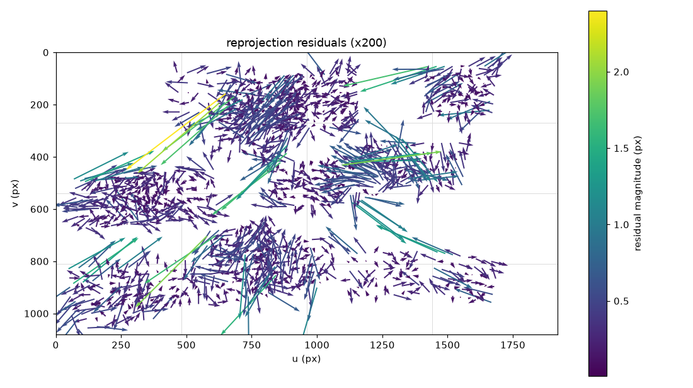

# 캘리브레이션 리포트 - 20260918_172133_luaz

카메라 `luaz` · 해상도 1920x1080 · 생성 2026-09-21T14:50:52+09:00

학습 30장 / 홀드아웃 15장 · 분할 시드 `0` (같은 시드면 같은 분할)

## 경고

- cx 가 화면 중심에서 80.0 px 벗어났다 (기준 50 px). cx=1040.0, 중심=960.0. 크롭됐거나 추정이 불안정하다
- k1 = 0.27515 로 양수다 (핀쿠션). 광각 렌즈는 보통 배럴(k1 < 0)이다. 보드가 화면 가장자리까지 오지 않았을 때 자주 나온다

## 0. 프레임별 재투영 오차와 이상치 제거

전체 45장으로 1차 추정한 RMS 는 **0.4165 px** 이었다. 이 추정의 목적은 K 가 아니라 프레임별 오차를 보는 것이다.

| 항목 | 값 |
|---|---|
| 중앙값 | 0.3428 px |
| MAD | 0.0783 px |
| robust sigma (1.4826*MAD) | 0.1161 px |
| 경계 (중앙값 + 3.0*sigma, 최소 0.3) | **0.6910 px** |
| 제거 / 남김 | 0장 / 45장 |

평균과 표준편차 대신 중앙값과 MAD 를 쓴다. 이상치가 평균과 표준편차를 끌고 가서 자기 자신을 정상으로 만들어 버리기 때문이다.

### 전체 프레임 (오차 큰 순)

| 프레임 | RMS (px) | 사용 |
|---|---|---|
| 038 | 0.6787 | 사용 |
| 037 | 0.6677 | 사용 |
| 035 | 0.6627 | 사용 |
| 041 | 0.6566 | 사용 |
| 036 | 0.6441 | 사용 |
| 039 | 0.6327 | 사용 |
| 042 | 0.6120 | 사용 |
| 034 | 0.6006 | 사용 |
| 010 | 0.5287 | 사용 |
| 031 | 0.4761 | 사용 |
| 012 | 0.4676 | 사용 |
| 024 | 0.4663 | 사용 |
| 043 | 0.4578 | 사용 |
| 044 | 0.4452 | 사용 |
| 013 | 0.4304 | 사용 |
| 032 | 0.4211 | 사용 |
| 014 | 0.4089 | 사용 |
| 029 | 0.3865 | 사용 |
| 023 | 0.3769 | 사용 |
| 016 | 0.3749 | 사용 |
| 025 | 0.3722 | 사용 |
| 015 | 0.3714 | 사용 |
| 033 | 0.3428 | 사용 |
| 021 | 0.3359 | 사용 |
| 005 | 0.3351 | 사용 |
| 006 | 0.3198 | 사용 |
| 008 | 0.3196 | 사용 |
| 022 | 0.3170 | 사용 |
| 011 | 0.3072 | 사용 |
| 040 | 0.3069 | 사용 |
| 000 | 0.3046 | 사용 |
| 004 | 0.3006 | 사용 |
| 026 | 0.2988 | 사용 |
| 017 | 0.2930 | 사용 |
| 003 | 0.2882 | 사용 |
| 007 | 0.2850 | 사용 |
| 019 | 0.2753 | 사용 |
| 009 | 0.2669 | 사용 |
| 020 | 0.2578 | 사용 |
| 030 | 0.2541 | 사용 |
| 028 | 0.2537 | 사용 |
| 018 | 0.2377 | 사용 |
| 001 | 0.2206 | 사용 |
| 027 | 0.2063 | 사용 |
| 002 | 0.2018 | 사용 |

## 1. 추정값

| 항목 | 값 |
|---|---|
| fx, fy | 1639.39, 1627.86 |
| cx, cy | 1039.96, 550.06 (화면 중심 960.0, 540.0) |
| D (opencv_5) | 0.275150, -0.072189, 0.005038, 0.033616, -0.157260 |
| fov_nominal | H 60.71 deg, V 36.70 deg |
| fov_effective (alpha=0) | H 57.13 deg, V 33.38 deg |

`fov_nominal` 과 `fov_effective` 는 다른 값이 정상이다. 앞은 왜곡을 무시한 값, 뒤는 왜곡을 펴고 검은 여백을 잘라낸 뒤 실제로 쓸 수 있는 화각이다.

## 2. RMS (이것만 보지 않는다)

| 구분 | RMS (px) | 해석 |
|---|---|---|
| 학습 30장 | 0.3934 | 설명 안 되는 요인 있음 |
| 홀드아웃 15장 | 0.4749 | 학습 대비 1.21배 |

RMS 는 **K, D 추정이 이 데이터에 잘 맞았다**는 뜻일 뿐, 그 K, D 가 좋은 target 이라는 뜻이 아니다. 아래 네 항목을 같이 본다.

### 2-1. 공간 분포 (4x4 셀별 평균 잔차 px, 괄호는 코너 수)

| v\u | 0 | 1 | 2 | 3 |
|---|---|---|---|---|
| **0** | 0.271 (6) | 0.299 (231) | 0.273 (97) | 0.276 (96) |
| **1** | 0.287 (87) | 0.321 (160) | 0.415 (170) | 0.264 (25) |
| **2** | 0.238 (147) | 0.302 (165) | 0.338 (61) | 0.470 (12) |
| **3** | 0.305 (144) | 0.292 (126) | 0.228 (53) | 0.238 (40) |

최대 셀: (3, 2) 평균 0.470 px. 한쪽에만 몰려 있으면 전체 RMS 가 낮아도 그 영역은 못 믿는다.

### 2-2. 잔차 방향성 (방사성)

| 항목 | 값 (px) |
|---|---|
| 방사 방향 평균 내적 | -0.0010 |
| 잔차 크기 평균 | 0.3028 |

0 근처면 잔차가 무작위 = 정상. 크게 치우쳐 있으면 잔차가 방사 방향으로 쏠린 것이고, 왜곡 모델이 데이터를 못 따라갔다는 신호다.



화살표는 잔차를 200배 확대한 것이다. 사방으로 흩어져 있으면 정상, 가장자리에서 일제히 한 방향이면 왜곡 모델 부족, 한 덩어리만 같은 방향이면 그 사진 한 장의 문제다 (흔들림, 보드 휨).

### 2-3. 파라미터 안정성 (학습 30장 중 15장씩 10회 재추정)

| 파라미터 | 전체 추정 | 부분집합 평균 | 표준편차 | 최대 편차 |
|---|---|---|---|---|
| fx | 1639.39 | 1607.59 | 57.78 | 153.78 |
| fy | 1627.86 | 1597.17 | 60.35 | 161.00 |
| cx | 1039.96 | 1011.94 | 29.50 | 94.60 |
| cy | 550.06 | 551.37 | 12.89 | 19.40 |

표준편차가 크면 RMS 가 낮아도 데이터가 파라미터를 결정하지 못한 것이다 (자세가 다 비슷하거나, 화면 가장자리가 비었거나, 장수가 부족하거나).

### 2-4. 홀드아웃 (K, D 고정, 사진마다 solvePnP 로 R, t 만)

| 프레임 | RMS (px) | 코너 수 |
|---|---|---|
| 005 | 0.3563 | 54 |
| 006 | 0.3375 | 54 |
| 007 | 0.3127 | 54 |
| 009 | 0.2534 | 54 |
| 012 | 0.4582 | 54 |
| 013 | 0.4203 | 54 |
| 014 | 0.4024 | 54 |
| 015 | 0.3617 | 54 |
| 029 | 0.3754 | 54 |
| 031 | 0.4585 | 54 |
| 033 | 0.3378 | 54 |
| 036 | 0.7770 | 54 |
| 037 | 0.7717 | 54 |
| 041 | 0.6490 | 54 |
| 044 | 0.4636 | 54 |

한 장만 유독 크면 그 사진을 의심한다 (흔들림, 보드가 화면을 벗어남). 전체가 고르게 크면 K, D 자체가 일반화되지 않는 것이다.

## 3. 재현

```bash
python src/run_calibrate.py data\luaz\20260918_172133_luaz --n-train 30 --seed 0 --outlier-k 3.0
```

