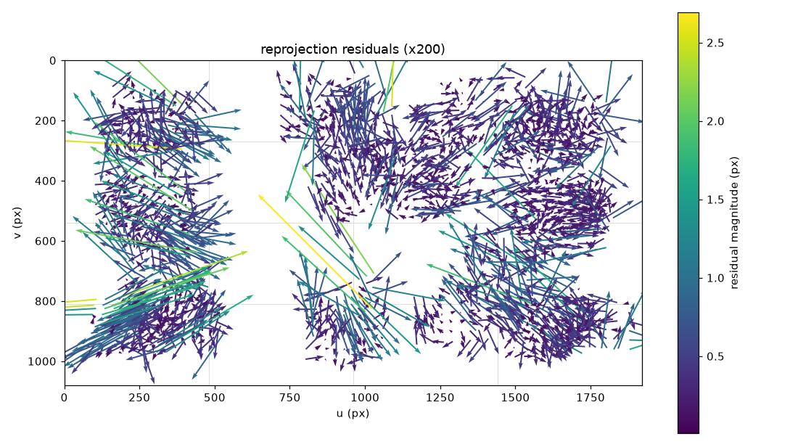

# 캘리브레이션 리포트 - 20260921_133454_s10+1

카메라 `s10` · 해상도 1920x1080 · 생성 2026-09-21T14:20:27+09:00

학습 40장 / 홀드아웃 21장 · 분할 시드 `0` (같은 시드면 같은 분할)

세션 2개를 합쳐 추정했다.

- `data\s10\20260921_133454_s10`
- `data\s10\20260921_135950_s10`

## 경고

- k1 = 0.29077 로 양수다 (핀쿠션). 광각 렌즈는 보통 배럴(k1 < 0)이다. 보드가 화면 가장자리까지 오지 않았을 때 자주 나온다

## 0. 프레임별 재투영 오차와 이상치 제거

전체 63장으로 1차 추정한 RMS 는 **0.7865 px** 이었다. 이 추정의 목적은 K 가 아니라 프레임별 오차를 보는 것이다.

| 항목 | 값 |
|---|---|
| 중앙값 | 0.3765 px |
| MAD | 0.1347 px |
| robust sigma (1.4826*MAD) | 0.1998 px |
| 경계 (중앙값 + 3.0*sigma, 최소 0.3) | **0.9758 px** |
| 제거 / 남김 | 2장 / 61장 |

평균과 표준편차 대신 중앙값과 MAD 를 쓴다. 이상치가 평균과 표준편차를 끌고 가서 자기 자신을 정상으로 만들어 버리기 때문이다.

### 제거된 프레임

| 프레임 | RMS (px) |
|---|---|
| 20260921_133454_s10/034 | 4.7298 |
| 20260921_135950_s10/021 | 1.1476 |

제거해도 **파일은 그대로 남는다.** meta.json 도 건드리지 않는다. 이 추정에서 빼기만 한 것이다.

### 전체 프레임 (오차 큰 순)

| 프레임 | RMS (px) | 사용 |
|---|---|---|
| 20260921_133454_s10/034 | 4.7298 | **제외** |
| 20260921_135950_s10/021 | 1.1476 | **제외** |
| 20260921_133454_s10/030 | 0.9499 | 사용 |
| 20260921_135950_s10/019 | 0.9442 | 사용 |
| 20260921_133454_s10/024 | 0.9259 | 사용 |
| 20260921_133454_s10/033 | 0.8766 | 사용 |
| 20260921_133454_s10/031 | 0.8627 | 사용 |
| 20260921_135950_s10/020 | 0.8502 | 사용 |
| 20260921_135950_s10/010 | 0.8264 | 사용 |
| 20260921_133454_s10/026 | 0.8110 | 사용 |
| 20260921_133454_s10/029 | 0.7720 | 사용 |
| 20260921_133454_s10/023 | 0.7614 | 사용 |
| 20260921_133454_s10/025 | 0.7587 | 사용 |
| 20260921_133454_s10/039 | 0.6824 | 사용 |
| 20260921_133454_s10/032 | 0.6506 | 사용 |
| 20260921_135950_s10/004 | 0.5899 | 사용 |
| 20260921_135950_s10/002 | 0.5774 | 사용 |
| 20260921_133454_s10/036 | 0.5594 | 사용 |
| 20260921_133454_s10/035 | 0.5550 | 사용 |
| 20260921_135950_s10/022 | 0.5302 | 사용 |
| 20260921_135950_s10/007 | 0.5269 | 사용 |
| 20260921_135950_s10/018 | 0.5265 | 사용 |
| 20260921_135950_s10/016 | 0.4821 | 사용 |
| 20260921_133454_s10/027 | 0.4695 | 사용 |
| 20260921_135950_s10/009 | 0.4536 | 사용 |
| 20260921_135950_s10/017 | 0.4327 | 사용 |
| 20260921_135950_s10/012 | 0.4269 | 사용 |
| 20260921_133454_s10/028 | 0.4253 | 사용 |
| 20260921_135950_s10/015 | 0.4221 | 사용 |
| 20260921_133454_s10/018 | 0.4168 | 사용 |
| 20260921_135950_s10/014 | 0.3926 | 사용 |
| 20260921_133454_s10/003 | 0.3765 | 사용 |
| 20260921_133454_s10/019 | 0.3751 | 사용 |
| 20260921_135950_s10/003 | 0.3641 | 사용 |
| 20260921_133454_s10/038 | 0.3615 | 사용 |
| 20260921_133454_s10/020 | 0.3336 | 사용 |
| 20260921_133454_s10/002 | 0.3301 | 사용 |
| 20260921_133454_s10/022 | 0.3179 | 사용 |
| 20260921_133454_s10/021 | 0.3108 | 사용 |
| 20260921_133454_s10/011 | 0.3081 | 사용 |
| 20260921_133454_s10/005 | 0.3045 | 사용 |
| 20260921_133454_s10/008 | 0.3024 | 사용 |
| 20260921_133454_s10/017 | 0.2983 | 사용 |
| 20260921_133454_s10/007 | 0.2975 | 사용 |
| 20260921_133454_s10/014 | 0.2959 | 사용 |
| 20260921_135950_s10/000 | 0.2864 | 사용 |
| 20260921_133454_s10/012 | 0.2810 | 사용 |
| 20260921_133454_s10/006 | 0.2772 | 사용 |
| 20260921_135950_s10/013 | 0.2709 | 사용 |
| 20260921_135950_s10/001 | 0.2700 | 사용 |
| 20260921_133454_s10/000 | 0.2658 | 사용 |
| 20260921_133454_s10/009 | 0.2656 | 사용 |
| 20260921_135950_s10/005 | 0.2574 | 사용 |
| 20260921_133454_s10/010 | 0.2417 | 사용 |
| 20260921_135950_s10/011 | 0.2413 | 사용 |
| 20260921_133454_s10/013 | 0.2358 | 사용 |
| 20260921_133454_s10/015 | 0.2299 | 사용 |
| 20260921_133454_s10/016 | 0.2257 | 사용 |
| 20260921_133454_s10/037 | 0.2222 | 사용 |
| 20260921_133454_s10/001 | 0.2095 | 사용 |
| 20260921_135950_s10/008 | 0.1994 | 사용 |
| 20260921_133454_s10/004 | 0.1788 | 사용 |
| 20260921_135950_s10/006 | 0.1566 | 사용 |

## 1. 추정값

| 항목 | 값 |
|---|---|
| fx, fy | 1770.07, 1773.95 |
| cx, cy | 931.04, 570.17 (화면 중심 960.0, 540.0) |
| D (opencv_5) | 0.290766, -0.944990, 0.012504, 0.003832, 2.188340 |
| fov_nominal | H 56.95 deg, V 33.86 deg |
| fov_effective (alpha=0) | H 53.49 deg, V 31.46 deg |

`fov_nominal` 과 `fov_effective` 는 다른 값이 정상이다. 앞은 왜곡을 무시한 값, 뒤는 왜곡을 펴고 검은 여백을 잘라낸 뒤 실제로 쓸 수 있는 화각이다.

## 2. RMS (이것만 보지 않는다)

| 구분 | RMS (px) | 해석 |
|---|---|---|
| 학습 40장 | 0.4965 | 설명 안 되는 요인 있음 |
| 홀드아웃 21장 | 0.5345 | 학습 대비 1.08배 |

RMS 는 **K, D 추정이 이 데이터에 잘 맞았다**는 뜻일 뿐, 그 K, D 가 좋은 target 이라는 뜻이 아니다. 아래 네 항목을 같이 본다.

### 2-1. 공간 분포 (4x4 셀별 평균 잔차 px, 괄호는 코너 수)

| v\u | 0 | 1 | 2 | 3 |
|---|---|---|---|---|
| **0** | 0.429 (120) | 0.336 (96) | 0.361 (138) | 0.325 (163) |
| **1** | 0.417 (154) | 0.266 (52) | 0.272 (235) | 0.259 (270) |
| **2** | 0.508 (156) | 0.694 (19) | 0.517 (60) | 0.414 (157) |
| **3** | 0.479 (203) | 0.362 (63) | 0.324 (82) | 0.365 (192) |

최대 셀: (1, 2) 평균 0.694 px. 한쪽에만 몰려 있으면 전체 RMS 가 낮아도 그 영역은 못 믿는다.

### 2-2. 잔차 방향성 (방사성)

| 항목 | 값 (px) |
|---|---|
| 방사 방향 평균 내적 | +0.0014 |
| 잔차 크기 평균 | 0.3720 |

0 근처면 잔차가 무작위 = 정상. 크게 치우쳐 있으면 잔차가 방사 방향으로 쏠린 것이고, 왜곡 모델이 데이터를 못 따라갔다는 신호다.



화살표는 잔차를 200배 확대한 것이다. 사방으로 흩어져 있으면 정상, 가장자리에서 일제히 한 방향이면 왜곡 모델 부족, 한 덩어리만 같은 방향이면 그 사진 한 장의 문제다 (흔들림, 보드 휨).

### 2-3. 파라미터 안정성 (학습 40장 중 15장씩 10회 재추정)

| 파라미터 | 전체 추정 | 부분집합 평균 | 표준편차 | 최대 편차 |
|---|---|---|---|---|
| fx | 1770.07 | 1783.81 | 62.11 | 101.31 |
| fy | 1773.95 | 1786.20 | 61.86 | 109.72 |
| cx | 931.04 | 928.88 | 12.57 | 16.03 |
| cy | 570.17 | 567.52 | 25.90 | 53.44 |

표준편차가 크면 RMS 가 낮아도 데이터가 파라미터를 결정하지 못한 것이다 (자세가 다 비슷하거나, 화면 가장자리가 비었거나, 장수가 부족하거나).

### 2-4. 홀드아웃 (K, D 고정, 사진마다 solvePnP 로 R, t 만)

| 프레임 | RMS (px) | 코너 수 |
|---|---|---|
| 005 | 0.2994 | 54 |
| 007 | 0.2880 | 54 |
| 009 | 0.2665 | 54 |
| 012 | 0.3003 | 54 |
| 013 | 0.2528 | 54 |
| 014 | 0.3050 | 54 |
| 015 | 0.2515 | 54 |
| 029 | 0.7574 | 54 |
| 031 | 0.8794 | 54 |
| 033 | 0.8849 | 54 |
| 039 | 0.6786 | 54 |
| 040 | 0.4392 | 54 |
| 041 | 0.4113 | 54 |
| 042 | 0.8651 | 54 |
| 046 | 0.1696 | 54 |
| 048 | 0.1944 | 54 |
| 050 | 0.8099 | 54 |
| 051 | 0.2685 | 54 |
| 057 | 0.4960 | 54 |
| 058 | 0.5765 | 54 |
| 062 | 0.6096 | 54 |

한 장만 유독 크면 그 사진을 의심한다 (흔들림, 보드가 화면을 벗어남). 전체가 고르게 크면 K, D 자체가 일반화되지 않는 것이다.

## 3. 재현

```bash
python src/run_calibrate.py data\s10\20260921_133454_s10 data\s10\20260921_135950_s10 --n-train 40 --seed 0 --outlier-k 3.0
```

