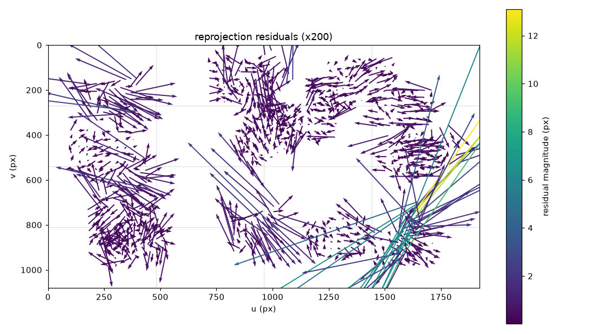

# 캘리브레이션 리포트 - 20260921_133454_s10

카메라 `s10` · 해상도 1920x1080 · 생성 2026-09-21T13:43:21+09:00

학습 20장 / 홀드아웃 20장 · 분할 시드 `0` (같은 시드면 같은 분할)

## 경고

- k1 = 0.38283 로 양수다 (핀쿠션). 광각 렌즈는 보통 배럴(k1 < 0)이다. 보드가 화면 가장자리까지 오지 않았을 때 자주 나온다
- 학습 RMS 1.150 px - 구조적 문제

## 1. 추정값

| 항목 | 값 |
|---|---|
| fx, fy | 1681.05, 1680.71 |
| cx, cy | 936.93, 538.69 (화면 중심 960.0, 540.0) |
| D (opencv_5) | 0.382833, -1.922768, 0.004385, 0.004588, 4.066875 |
| fov_nominal | H 59.46 deg, V 35.62 deg |
| fov_effective (alpha=0) | H 55.50 deg, V 32.77 deg |

`fov_nominal` 과 `fov_effective` 는 다른 값이 정상이다. 앞은 왜곡을 무시한 값, 뒤는 왜곡을 펴고 검은 여백을 잘라낸 뒤 실제로 쓸 수 있는 화각이다.

## 2. RMS (이것만 보지 않는다)

| 구분 | RMS (px) | 해석 |
|---|---|---|
| 학습 20장 | 1.1503 | 구조적 문제 |
| 홀드아웃 20장 | 0.5226 | 학습 대비 0.45배 |

RMS 는 **K, D 추정이 이 데이터에 잘 맞았다**는 뜻일 뿐, 그 K, D 가 좋은 target 이라는 뜻이 아니다. 아래 네 항목을 같이 본다.

### 2-1. 공간 분포 (4x4 셀별 평균 잔차 px, 괄호는 코너 수)

| v\u | 0 | 1 | 2 | 3 |
|---|---|---|---|---|
| **0** | 0.762 (35) | 0.292 (80) | 0.308 (118) | 0.276 (45) |
| **1** | 0.392 (71) | 0.219 (44) | 0.205 (117) | 0.306 (115) |
| **2** | 0.459 (99) | 0.663 (19) | 0.624 (27) | 2.929 (44) |
| **3** | 0.260 (104) | 0.489 (33) | 0.324 (45) | 0.876 (84) |

최대 셀: (3, 2) 평균 2.929 px. 한쪽에만 몰려 있으면 전체 RMS 가 낮아도 그 영역은 못 믿는다.

### 2-2. 잔차 방향성 (방사성)

| 항목 | 값 (px) |
|---|---|
| 방사 방향 평균 내적 | -0.0002 |
| 잔차 크기 평균 | 0.4913 |

0 근처면 잔차가 무작위 = 정상. 크게 치우쳐 있으면 잔차가 방사 방향으로 쏠린 것이고, 왜곡 모델이 데이터를 못 따라갔다는 신호다.



화살표는 잔차를 200배 확대한 것이다. 사방으로 흩어져 있으면 정상, 가장자리에서 일제히 한 방향이면 왜곡 모델 부족, 한 덩어리만 같은 방향이면 그 사진 한 장의 문제다 (흔들림, 보드 휨).

### 2-3. 파라미터 안정성 (학습 20장 중 15장씩 10회 재추정)

| 파라미터 | 전체 추정 | 부분집합 평균 | 표준편차 | 최대 편차 |
|---|---|---|---|---|
| fx | 1681.05 | 1688.87 | 45.14 | 101.76 |
| fy | 1680.71 | 1688.14 | 44.63 | 97.92 |
| cx | 936.93 | 935.98 | 10.63 | 17.52 |
| cy | 538.69 | 546.22 | 19.99 | 46.72 |

표준편차가 크면 RMS 가 낮아도 데이터가 파라미터를 결정하지 못한 것이다 (자세가 다 비슷하거나, 화면 가장자리가 비었거나, 장수가 부족하거나).

### 2-4. 홀드아웃 (K, D 고정, 사진마다 solvePnP 로 R, t 만)

| 프레임 | RMS (px) | 코너 수 |
|---|---|---|
| 005 | 0.2401 | 54 |
| 006 | 0.3396 | 54 |
| 007 | 0.3160 | 54 |
| 008 | 0.3955 | 54 |
| 009 | 0.3618 | 54 |
| 012 | 0.3631 | 54 |
| 013 | 0.3171 | 54 |
| 014 | 0.2554 | 54 |
| 015 | 0.2146 | 54 |
| 016 | 0.2222 | 54 |
| 019 | 0.3116 | 54 |
| 021 | 0.2386 | 54 |
| 025 | 0.7044 | 54 |
| 029 | 0.7637 | 54 |
| 031 | 0.8744 | 54 |
| 032 | 0.7387 | 54 |
| 033 | 0.9438 | 54 |
| 035 | 0.5108 | 54 |
| 036 | 0.6122 | 54 |
| 039 | 0.6630 | 54 |

한 장만 유독 크면 그 사진을 의심한다 (흔들림, 보드가 화면을 벗어남). 전체가 고르게 크면 K, D 자체가 일반화되지 않는 것이다.

## 3. 재현

```bash
python src/run_calibrate.py data\s10\20260921_133454_s10 --n-train 20 --seed 0
```

