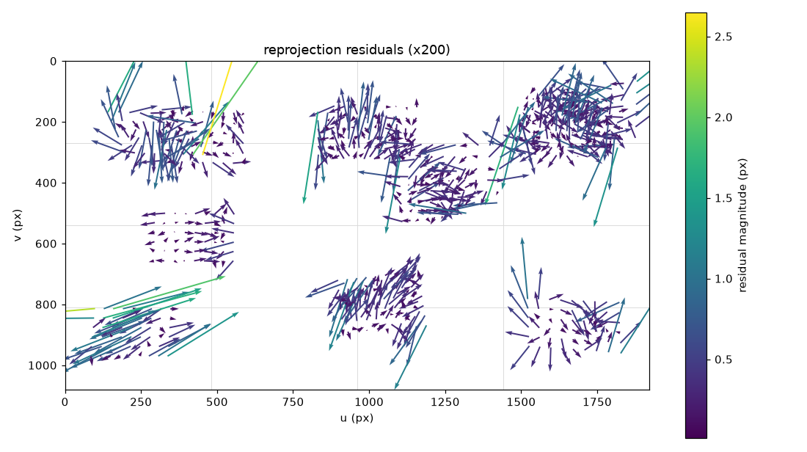

# 캘리브레이션 리포트 - 20260921_135950_s10

카메라 `s10` · 해상도 1920x1080 · 생성 2026-09-21T14:54:10+09:00

학습 15장 / 홀드아웃 6장 · 분할 시드 `0` (같은 시드면 같은 분할)

## 경고

- k1 = 0.23070 로 양수다 (핀쿠션). 광각 렌즈는 보통 배럴(k1 < 0)이다. 보드가 화면 가장자리까지 오지 않았을 때 자주 나온다
- 안정성 검사 부분집합이 15장에서 14장으로 줄었다 (학습이 15장뿐). 부분집합이 작을수록 표준편차가 과장되므로 값을 그대로 믿지 말고, 더 찍어서 다시 본다

## 0. 프레임별 재투영 오차와 이상치 제거

전체 23장으로 1차 추정한 RMS 는 **0.5244 px** 이었다. 이 추정의 목적은 K 가 아니라 프레임별 오차를 보는 것이다.

| 항목 | 값 |
|---|---|
| 중앙값 | 0.3870 px |
| MAD | 0.1087 px |
| robust sigma (1.4826*MAD) | 0.1612 px |
| 경계 (중앙값 + 3.0*sigma, 최소 0.3) | **0.8704 px** |
| 제거 / 남김 | 2장 / 21장 |

평균과 표준편차 대신 중앙값과 MAD 를 쓴다. 이상치가 평균과 표준편차를 끌고 가서 자기 자신을 정상으로 만들어 버리기 때문이다.

### 제거된 프레임

| 프레임 | RMS (px) |
|---|---|
| 019 | 0.9329 |
| 021 | 1.1202 |

제거해도 **파일은 그대로 남는다.** meta.json 도 건드리지 않는다. 이 추정에서 빼기만 한 것이다.

### 전체 프레임 (오차 큰 순)

| 프레임 | RMS (px) | 사용 |
|---|---|---|
| 021 | 1.1202 | **제외** |
| 019 | 0.9329 | **제외** |
| 020 | 0.8419 | 사용 |
| 010 | 0.8295 | 사용 |
| 004 | 0.5876 | 사용 |
| 007 | 0.5267 | 사용 |
| 018 | 0.4785 | 사용 |
| 012 | 0.4737 | 사용 |
| 002 | 0.4634 | 사용 |
| 009 | 0.4546 | 사용 |
| 016 | 0.4171 | 사용 |
| 015 | 0.3870 | 사용 |
| 017 | 0.3804 | 사용 |
| 003 | 0.3629 | 사용 |
| 014 | 0.3604 | 사용 |
| 022 | 0.3382 | 사용 |
| 013 | 0.3060 | 사용 |
| 005 | 0.2783 | 사용 |
| 000 | 0.2781 | 사용 |
| 001 | 0.2729 | 사용 |
| 006 | 0.2268 | 사용 |
| 011 | 0.2168 | 사용 |
| 008 | 0.1970 | 사용 |

## 1. 추정값

| 항목 | 값 |
|---|---|
| fx, fy | 1596.87, 1597.23 |
| cx, cy | 919.67, 507.96 (화면 중심 960.0, 540.0) |
| D (opencv_5) | 0.230699, -0.510541, 0.002443, -0.002165, 0.850068 |
| fov_nominal | H 62.03 deg, V 37.36 deg |
| fov_effective (alpha=0) | H 58.53 deg, V 34.97 deg |

`fov_nominal` 과 `fov_effective` 는 다른 값이 정상이다. 앞은 왜곡을 무시한 값, 뒤는 왜곡을 펴고 검은 여백을 잘라낸 뒤 실제로 쓸 수 있는 화각이다.

## 2. RMS (이것만 보지 않는다)

| 구분 | RMS (px) | 해석 |
|---|---|---|
| 학습 15장 | 0.4730 | 설명 안 되는 요인 있음 |
| 홀드아웃 6장 | 0.3997 | 학습 대비 0.84배 |

RMS 는 **K, D 추정이 이 데이터에 잘 맞았다**는 뜻일 뿐, 그 K, D 가 좋은 target 이라는 뜻이 아니다. 아래 네 항목을 같이 본다.

### 2-1. 공간 분포 (4x4 셀별 평균 잔차 px, 괄호는 코너 수)

| v\u | 0 | 1 | 2 | 3 |
|---|---|---|---|---|
| **0** | 0.465 (56) | 0.282 (42) | 0.280 (44) | 0.348 (179) |
| **1** | 0.424 (40) | 0.251 (30) | 0.313 (130) | 0.350 (37) |
| **2** | 0.145 (24) | 0.358 (24) | 0.332 (52) | 0.518 (9) |
| **3** | 0.671 (54) | 0.313 (11) | 0.326 (33) | 0.318 (45) |

최대 셀: (0, 3) 평균 0.671 px. 한쪽에만 몰려 있으면 전체 RMS 가 낮아도 그 영역은 못 믿는다.

### 2-2. 잔차 방향성 (방사성)

| 항목 | 값 (px) |
|---|---|
| 방사 방향 평균 내적 | +0.0045 |
| 잔차 크기 평균 | 0.3571 |

0 근처면 잔차가 무작위 = 정상. 크게 치우쳐 있으면 잔차가 방사 방향으로 쏠린 것이고, 왜곡 모델이 데이터를 못 따라갔다는 신호다.



화살표는 잔차를 200배 확대한 것이다. 사방으로 흩어져 있으면 정상, 가장자리에서 일제히 한 방향이면 왜곡 모델 부족, 한 덩어리만 같은 방향이면 그 사진 한 장의 문제다 (흔들림, 보드 휨).

### 2-3. 파라미터 안정성 (학습 15장 중 14장씩 10회 재추정)

| 파라미터 | 전체 추정 | 부분집합 평균 | 표준편차 | 최대 편차 |
|---|---|---|---|---|
| fx | 1596.87 | 1596.88 | 9.28 | 14.23 |
| fy | 1597.23 | 1596.81 | 8.37 | 11.76 |
| cx | 919.67 | 919.43 | 5.00 | 10.05 |
| cy | 507.96 | 503.62 | 4.14 | 10.28 |

표준편차가 크면 RMS 가 낮아도 데이터가 파라미터를 결정하지 못한 것이다 (자세가 다 비슷하거나, 화면 가장자리가 비었거나, 장수가 부족하거나).

### 2-4. 홀드아웃 (K, D 고정, 사진마다 solvePnP 로 R, t 만)

| 프레임 | RMS (px) | 코너 수 |
|---|---|---|
| 001 | 0.2797 | 54 |
| 005 | 0.2996 | 54 |
| 009 | 0.4573 | 54 |
| 014 | 0.3889 | 54 |
| 015 | 0.4541 | 54 |
| 022 | 0.4732 | 54 |

한 장만 유독 크면 그 사진을 의심한다 (흔들림, 보드가 화면을 벗어남). 전체가 고르게 크면 K, D 자체가 일반화되지 않는 것이다.

## 3. 재현

```bash
python src/run_calibrate.py data\s10\20260921_135950_s10 --n-train 15 --seed 0 --outlier-k 3.0
```

