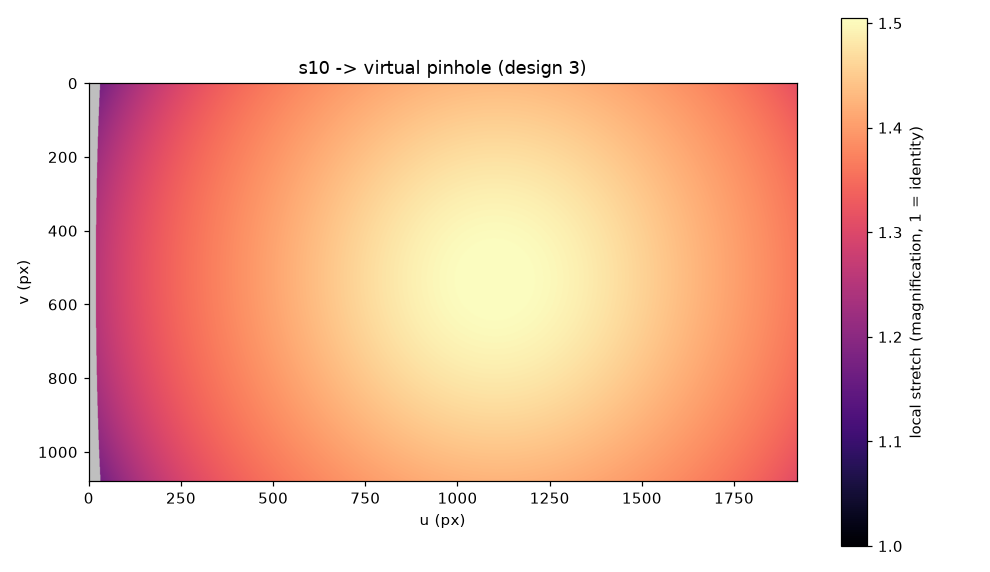
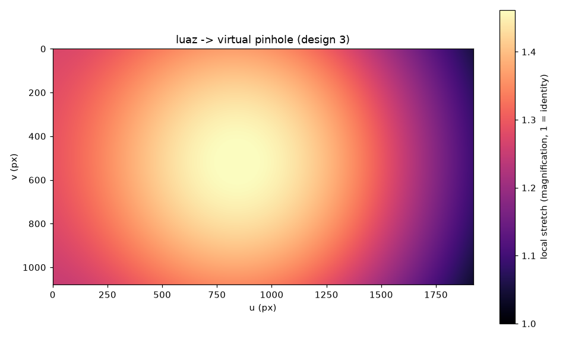
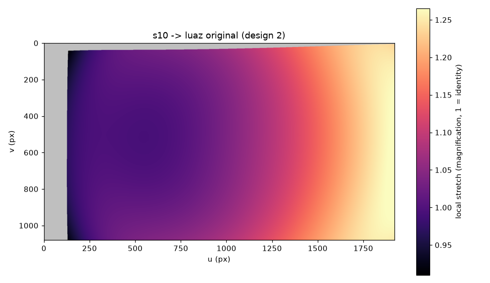

# target 공간 비교 - 숫자만

생성 2026-09-21T14:57:23+09:00

- 변환할 카메라 (src): **s10** · 20260921_135950_s10 · 1920x1080
- 기준 카메라 (dst):  **luaz** · 20260918_172133_luaz · 1920x1080

이 문서는 **결정하지 않는다.** README 의 미정 결정(② LUAZ 원본 vs ③ 가상 카메라)에 필요한 숫자만 낸다. 최종 결정은 사람이 한다.

## 1. 두 카메라의 화각

| 카메라 | fov_nominal (도) | fov_effective alpha=0 (도) |
|---|---|---|
| s10 | H 62.03 / V 37.36 | H 58.53 / V 34.97 |
| luaz | H 60.71 / V 36.70 | H 57.13 / V 33.38 |

두 값이 다른 것이 정상이다. `fov_nominal` 은 왜곡을 무시한 값이고, `fov_effective` 는 왜곡을 편 뒤 alpha=0 으로 잘라낸 실제로 쓸 수 있는 화각이다. 배럴 렌즈에서는 effective 가 nominal 보다 **넓다**.

## 2. 게이트: LUAZ fov ⊆ S10 usable fov

두 값 모두 **fov_effective** 로 비교한다 (`fov_nominal` 은 배럴 렌즈의 화각을 과소평가한다).

| 축 | dst (기준) | src (변환할 쪽) | 여유 (src - dst) | 판정 |
|---|---|---|---|---|
| H | 57.13 | 58.53 | +1.39 | 통과 |
| V | 33.38 | 34.97 | +1.59 | 통과 |

**통과.** luaz 의 화각이 s10 안에 들어온다. 두 설계 모두 기하학적으로 시도할 수 있다.

> **게이트는 선별용. ②의 모서리 커버리지는 valid_ratio로 판정한다.**
>
> 이 게이트는 H 와 V 를 **축별로** 비교한다. 두 축이 모두 통과해도 화면 **모서리**는 따로다 - 대각 방향은 H 도 V 도 아니고, 왜곡 때문에 화각의 경계선이 직사각형이 아니기 때문이다. 모서리가 실제로 채워지는지는 4장의 `s10 -> luaz 원본` valid pixel ratio 가 답한다 (모자란 만큼이 곧 검은 영역이고, 히트맵에서 회색으로 보인다).

## 3. 설계 ③ 가상 카메라 = target

`K_target` = luaz 의 K' (alpha=0 유도값) x **1.10**, fx = 1939.6, 화각 H 52.67 / V 30.49 도. `D_target` = **0**. 공통 공간에 왜곡이 없어 직선이 직선으로 남는다. 대신 배포 시 luaz 영상도 매 프레임 변환해야 한다.

### s10 -> 가상 카메라 (설계 ③)

| 지표 | 값 | 기준 |
|---|---|---|
| valid pixel ratio | 98.77% | >= 98% |
| local stretch 중앙값 (면적) | 1.4186 | - |
| local stretch 95p (면적) | 1.4955 | <= 1.15 |
| local stretch 최대 (면적) | 1.5069 (u=1098, v=530) | - |
| local stretch 최소 (면적) | 1.1714 | - |
| 같은 값의 선형 배율 (한 변) | 중앙값 1.1911 / 95p 1.2229 / 최대 1.2276 | - |
| 두 기준 동시 충족 | **미충족** | |

회색은 원본 밖에서 가져와야 하는 영역이다 = 검은 영역이 생길 자리. 밝을수록 확대가 크고, 확대된 곳은 보간으로 뭉개진다.

### luaz -> 가상 카메라 (설계 ③)

| 지표 | 값 | 기준 |
|---|---|---|
| valid pixel ratio | 100.00% | >= 98% |
| local stretch 중앙값 (면적) | 1.3439 | - |
| local stretch 95p (면적) | 1.4512 | <= 1.15 |
| local stretch 최대 (면적) | 1.4646 (u=847, v=512) | - |
| local stretch 최소 (면적) | 1.0407 | - |
| 같은 값의 선형 배율 (한 변) | 중앙값 1.1593 / 95p 1.2047 / 최대 1.2102 | - |
| 두 기준 동시 충족 | **미충족** | |

회색은 원본 밖에서 가져와야 하는 영역이다 = 검은 영역이 생길 자리. 밝을수록 확대가 크고, 확대된 곳은 보간으로 뭉개진다.

## 4. 설계 ② LUAZ 원본 = target

`K_target` = luaz 의 K, `D_target` = **luaz 의 D**. luaz 영상을 전혀 건드리지 않는다 (배포 시 변환 없음). 대신 s10 영상에 luaz 의 왜곡을 일부러 만들어 넣는다.

### s10 -> luaz 원본 (설계 ②)

| 지표 | 값 | 기준 |
|---|---|---|
| valid pixel ratio | 90.94% | >= 98% |
| local stretch 중앙값 (면적) | 1.0556 | - |
| local stretch 95p (면적) | 1.2523 | <= 1.15 |
| local stretch 최대 (면적) | 1.2714 (u=1919, v=735) | - |
| local stretch 최소 (면적) | 0.9103 | - |
| 같은 값의 선형 배율 (한 변) | 중앙값 1.0274 / 95p 1.1191 / 최대 1.1276 | - |
| 두 기준 동시 충족 | **미충족** | |

회색은 원본 밖에서 가져와야 하는 영역이다 = 검은 영역이 생길 자리. 밝을수록 확대가 크고, 확대된 곳은 보간으로 뭉개진다.

### luaz (설계 ②)

**변환 없음.** 설계 ② 의 target 이 luaz 원본 그 자체이므로 valid pixel ratio = 1.0, local stretch = 1.0 이다 (계산할 것이 없다). 이것이 설계 ② 의 유일한 실질적 이점이다 - 배포 경로에 remap 단계가 없다.

## 4-1. f_target 탐색 (설계 ③ 전용)

설계 ③ 은 목적지가 가상 카메라라 **화각을 우리가 정할 수 있다.** `f_target` 을 5% 씩 올리며 valid pixel ratio 가 98% 를 넘는 **최소 배율**을 찾았다.

| 배율 | fx | 화각 H (도) | valid src | valid dst | stretch 95p src | 판정 |
|---|---|---|---|---|---|---|
| 1.00 | 1763.3 | 57.13 | 93.59% | 100.00% | 1.2346 | - |
| 1.05 | 1851.4 | 54.82 | 96.24% | 100.00% | 1.3620 | - |
| 1.10 | 1939.6 | 52.67 | 98.77% | 100.00% | 1.4955 | **통과** |

**선택: 배율 1.10.** 기준을 넘기는 가장 덜 좁힌 값이다. 더 올리면 valid 는 계속 좋아지지만 화각을 그만큼 버린다.

> **valid 와 stretch 는 반대로 움직인다.** f_target 을 올리면 같은 화면을 더 좁은 각도로 채우게 되므로 국소 확대가 **커진다**. 위 표에서 배율이 오를수록 stretch 95p 가 함께 오르는 것이 그것이다. 검은 영역을 줄이는 대가로 확대를 받는 거래이므로, 둘 다 만족하는 값이 없을 수 있다.

## 5. 판정 참고

- **기하학적으로 적합**: valid pixel ratio >= 98% **이고** local stretch 95p <= 1.15
- 그 외는 위 수치를 그대로 읽는다. 자동으로 탈락시키지 않는다

> stretch 는 **면적 배율**이다 (야코비안 행렬식). 판정선 1.15 는 선형으로는 1.072 배이므로, 두 카메라의 초점거리가 7% 만 달라도 그것만으로 걸린다. 표에 선형 배율을 같이 실어 두었으니 판정선을 어느 쪽에 걸지는 실측값을 보고 정한다.

| 설계 | 변환 | 기하학적 적합 |
|---|---|---|
| ③ 가상 카메라 | s10 -> 가상 카메라 (설계 ③) | **미달** |
| ③ 가상 카메라 | luaz -> 가상 카메라 (설계 ③) | **미달** |
| ② LUAZ 원본 | s10 -> luaz 원본 (설계 ②) | **미달** |
| ② LUAZ 원본 | luaz (설계 ②) | 변환 없음 |

**이 표는 결정이 아니다.** '기하학적으로 가능한가'까지만 답한다. '실제로 좋은 선택인가'는 리샘플링이 모델 성능에 얼마나 영향을 주는지의 문제이므로 변환 영상의 SSIM / edge / MTF 비교, 필요하면 모델 성능까지 보고 사람이 정한다 (README 판정 절차 3, 4).

## 6. 이 리포트에 RMS 가 없는 이유

RMS 는 `(K, D)` 추정이 **그 데이터에 잘 맞았다**는 뜻이고, 그 카메라가 좋은 target 인지와는 무관하다. RMS 가 낮은 카메라를 target 으로 고를 이유가 없다. 추정 품질은 3단계 리포트(`results/reports/<session_id>.md`)에서 본다.

