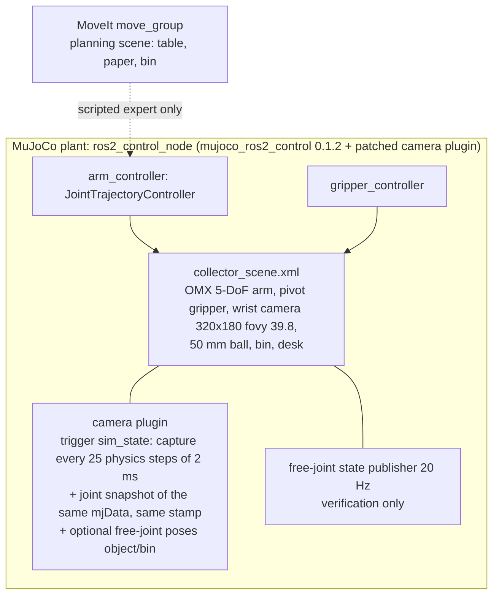
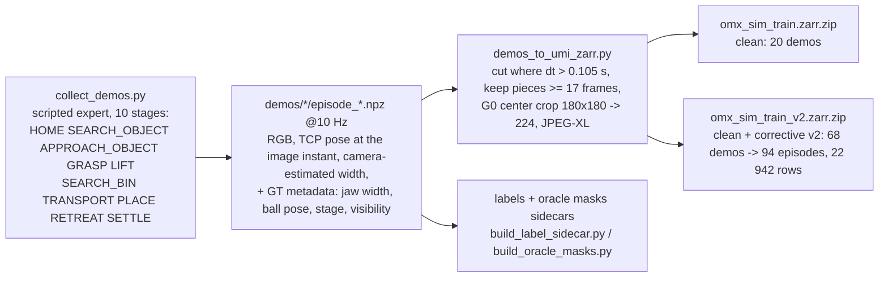
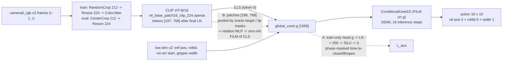
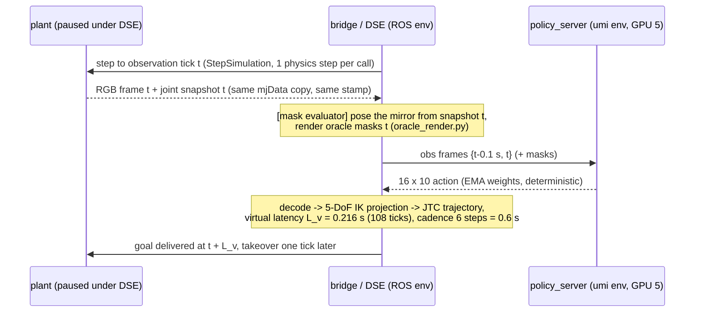

# Architecture

The system has two halves. Most of the work in this tree is the second.

1. **Real-data path** (first phase). Phone-recorded sessions are processed on a CPU
   server, mirrored to a GPU server, built into a UMI zarr and trained there. The
   policy is then handed off for inference on a Jetson.
2. **Simulation path.** A MuJoCo + ROS 2 twin of the OMX cell covers a scripted
   expert, demonstrations, training, and closed-loop evaluation under controlled
   timing.

## 1. Real-data path (omx/, README_GPU_WORKFLOW.md, README_CPU_GPU_SYNC.md, jetson_handoff/)

## 2. The simulated cell

- **Wrist camera.** Position, pitch and fovy were matched to recordings from the real
  collector (`sim_umi/reference/`, `sim_umi/PROJECT_STATUS.md`).
- **Magenta fingertip patches.** They exist only so the gripper width can be read from
  the image (`gripper_vision.py`). They are painted out before the policy sees the
  frame.

## 3. Data: scripted expert -> demos -> zarr

- **Policy inputs.** Wrist RGB, relative EE pose (pos + rot6d), rotation relative to
  the start, and the camera-estimated gripper width. Ground truth is recorded but is
  never a policy input.
- **Sidecars.** The label and oracle-mask sidecars are row-aligned with the zarr. They
  never modify it. See `sim_umi/train_results/2026-09-27_aux_prep/PREP_REPORT.md`.

## 4. The policy

- **Training.** AdamW at 3e-4, with the encoder at 3e-5. Cosine schedule with 2000
  warmup steps. 11 400 successful updates, batch 64, fp16 AMP, EMA, seed 42, and a
  shared initial state `a4cd264f` for every variant.
- **Configs.** They are in `diffusion_policy/config/train_diffusion_unet_timm_omx_*`:
  `_workspace` (G0), `_rect_` (G2), `_timing_aux_` (A) and
  `_oracle_tip_relation_film_` (B).
- **Ablation A.** The auxiliary head reads the diffusion condition `g`. Supervision is
  phase-masked: APPROACH trains close, GRASP_LIFT trains lift, TRANSPORT trains open.
  L = L_diff + 0.1 x masked SmoothL1. `predict_action` is unchanged.
- **Ablation B.** Patch tokens come from the same final-normalised tensor as CLS. They
  are pooled by area occupancy under the post-crop oracle masks. The relation vector is
  [f_T, f_E, f_T-f_E, f_T*f_E, dcx, dcy, log area ratio, presences]. It drives
  CLS' = CLS * (1 + gamma) + beta with a zero-initialised last layer, so step 0 is G0
  exactly. Frames whose target is missing or invalid fall back hard to CLS.
- **Controlled comparisons.** New modules are built in a forked CPU RNG, so batch order,
  crops, jitter and diffusion noise stay identical to G0's. This is proven by a twin
  gate (`sim_umi/scripts/aux/`).

## 5. Closed loop and the two evaluators

- **Asynchronous evaluator** (`policy_rollout.py` + `rolling_executor.py`). It runs in
  real time with a rolling executor and latency compensation. It is kept for history.
  Its repeats were not reproducible, and a stale-clock bug was found in it
  (`sim_umi/train_results/2026-09-27_fov/DSE_DESIGN.md`).
- **Timing-controlled evaluator (DSE)** (`dse_rollout.py`). The plant is paused and
  stepped tick by tick, and every event is placed on an integer physics tick. Each
  episode passes hard gates: timeline invariants, arm/jaw continuity (lock check),
  exact observation ticks, the JTC takeover tick, and no anomalies. Renderer noise
  (+-1 grey level) is not controlled, so repeats diverge after a few plans. A pass is
  recorded as `GATE_PASS_<code hash>.json`.
- **Mask-capable evaluator** (`dse_rollout_masks.py`, used for B and its control). It
  wraps two methods of the DSE's bridge and changes none of its files. The masks come
  from the joint snapshot of the frame's own tick, via a plugin extension built into a
  separate overlay. The G0 control receives the same masks under ignored names. Its
  pass marker is `GATE_PASS_MASKS_<hash>.json`.

## 6. Metrics (sim_umi/scripts/definitive/aggregate.py)

- **corridor.** The ball entered the grasp corridor in the tool frame.
- **lifted.** Ball z > radius + 20 mm.
- **strict.** GT secure grasp: over a lifted stretch, the ball stays rigid in the tool
  frame within 4 mm for at least 0.5 s while the tool travels at least 30 mm.
- **bin.** The ball is in the bin.
- **abort.** Eight plans in a row the arm could not reach.
- **First-close geometry.** The ball's offset in the tool frame at close onset (depth,
  vertical, pitch), compared with the scripted expert.
