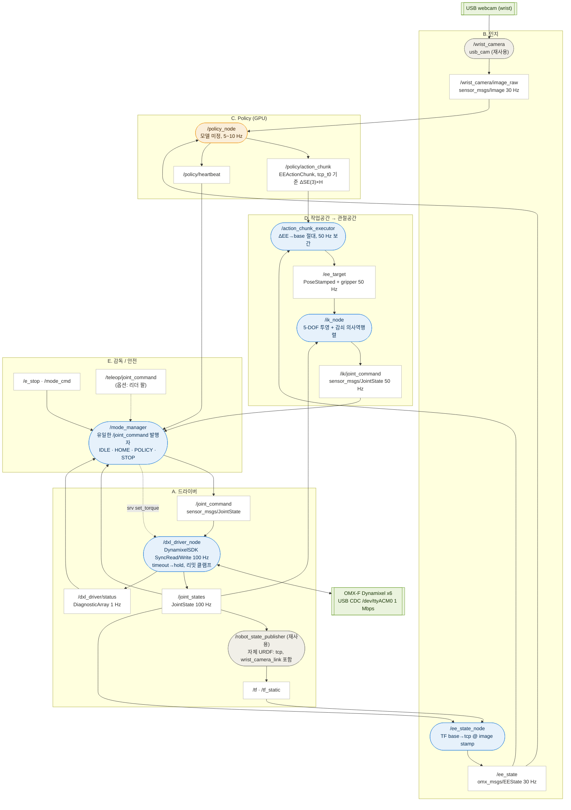

# 제어 파트 ROS 2 아키텍처 (v1, 2026-09-18)

> 목적: Jetson Orin Nano 위에서 **Policy 출력(EE trajectory) → OMX-F 관절 명령**까지의 ROS 2 노드/토픽 구조를 잡고, rqt_graph 형태로 그린다.
> v0(ROBOTIS 스택 재사용 전제)에서 v1(자체 스택)으로 개정. v0의 조사 내용은 7절에 참고용으로 남김.

---

## 0. 확정된 결정

| # | 결정 | 근거 |
|---|---|---|
| 1 | ROBOTIS 패키지는 그대로 쓰지 않는다. DynamixelSDK와 하드웨어 사실, URDF 기하만 가져온다 | 직접 구성이 목표 |
| 2 | 드라이버는 **1안: 자체 `dxl_driver_node`** (ros2_control 없음) | 스트리밍 제어라 JTC 의미가 작음. 수업 노드 스타일과 일치 |
| 3 | Policy 출력 좌표계는 **현재 TCP 기준 ΔEE** (UMI식) | 런타임에 target pose 추정이 필요 없음 |
| 4 | 웹캠은 수집기 스마트폰과 같은 상대 자세로 그리퍼에 장착 | 학습/실행 시점 일치 |
| 5 | ROS 2 배포판은 **Humble**, Jetson·개발PC 모두 동일 | 자체 스택이라 Jazzy 제약 없음. JetPack 6 = Ubuntu 22.04 |
| 6 | Policy 모델은 미정. 노드 인터페이스(image + ee_state → action_chunk)를 고정 | 모델 교체 가능 |

---

## 1. 환경 구성 — Docker는 필요한가

결론: **필수 아님.** 자체 스택이면 Jetson에서 Humble을 네이티브로 쓴다. 다만 두 지점에서 선택지로 남는다.

| 위치 | 기본 방침 | Docker가 필요해지는 경우 |
|---|---|---|
| Jetson (JetPack 6.x, Ubuntu 22.04) | `apt`로 ROS 2 Humble 설치. PyTorch는 NVIDIA/Jetson AI Lab이 배포하는 JetPack 6용 wheel(`pypi.jetson-ai-lab.io/jp6/cu126`)을 pip로 설치. TensorRT는 JetPack에 포함 | Policy가 요구하는 torch/CUDA 조합이 JetPack과 충돌할 때 → `jetson-containers`의 `ros:humble-pytorch` 계열 이미지로 policy_node만 컨테이너화. ROS 그래프는 바뀌지 않음(호스트 네트워크로 DDS 통과). Policy 확정 후 판단 |
| 개발 PC (Windows) | WSL2 Ubuntu 22.04 + Humble (수업 환경과 같고 Melodic만 Humble로 바뀜) | Docker Desktop은 USB·DDS 문제로 비추천 |
| GPU 학습 서버 | 제어 파트와 무관 | 학습 파트 결정 |

### 주의점
- **WSL2 ↔ Jetson 통신.** WSL2 기본 NAT는 DDS 멀티캐스트 디스커버리를 통과시키지 않아 Jetson 토픽이 노트북에서 안 보인다. mirrored 모드도 Hyper-V 방화벽 등 예외가 많다. **Fast DDS Discovery Server**를 Jetson에 띄우고 모든 머신이 `ROS_DISCOVERY_SERVER=<jetson-ip>:11811`로 유니캐스트 접속하는 방식을 기본으로 한다. rviz2·rqt_graph·rosbag2는 이 경로로 원격 사용.
- **USB 장치.** OMX-F는 `/dev/ttyACM0`(CDC-ACM)으로 잡힌다. U2D2용 FTDI `latency_timer` 조정은 해당 없음(실물에서 확인). udev 규칙으로 `dialout` 권한과 고정 심볼릭 링크(`/dev/omx_arm`, `/dev/wrist_cam`)를 만든다.
- **DynamixelSDK.** Humble용 ROS 2 패키지(`dynamixel_sdk`)가 릴리스되어 있다. apt에 없으면 `humble` 브랜치를 워크스페이스에서 소스 빌드.
- **동일 배포판.** Jetson과 모든 개발 PC가 Humble이어야 메시지 호환에 문제가 없다.

---

## 2. 구조

```
[F] 개발 PC       rviz2 · rqt_graph · rosbag2   (Discovery Server 경유)
────────────────────────────────────────────────── Jetson Orin Nano (Humble native) ──
[E] 감독/안전      mode_manager: 유일한 /joint_command 발행자. e_stop · watchdog · 모드 전환
[D] 작업공간→관절   action_chunk_executor → /ee_target → ik_node → /ik/joint_command
[C] Policy(GPU)    policy_node: image + ee_state → action_chunk(ΔEE, 5~10 Hz)
[B] 인지           wrist_camera(재사용) · ee_state_node
[A] 드라이버        dxl_driver_node(100 Hz) · robot_state_publisher(재사용, 자체 URDF)
────────────────────────────────────────────────── USB CDC 1 Mbps ──
     OMX-F Dynamixel ×6
```

### 다이어그램 (Mermaid — VS Code 미리보기/GitHub에서 렌더링. Graphviz 버전은 [`rqt_graph_draft.dot`](rqt_graph_draft.dot), 렌더링 [`rqt_graph_draft.png`](rqt_graph_draft.png))



범례: 파란색 = 우리가 구현, 회색 = 재사용하는 범용 ROS 패키지(ROBOTIS 아님), 주황 = GPU 추론, 흰 사각형 = 토픽, 녹색 = 하드웨어.

### 노드 목록

| 층 | 노드 | 출처 | 구독 | 발행 / 서비스 | 주기 |
|---|---|---|---|---|---|
| A | `/dxl_driver_node` | 우리 (C++) | `/joint_command` | `/joint_states`, `/dxl_driver/status`; srv `/dxl_driver/set_torque`(SetBool), `/dxl_driver/reboot` | 100 Hz |
| A | `/robot_state_publisher` | 재사용 | `/joint_states`, `/robot_description` | `/tf`, `/tf_static` | 100 Hz |
| B | `/wrist_camera` | 재사용 (usb_cam 또는 v4l2_camera) | — | `/wrist_camera/image_raw`, `/camera_info`, `/image_raw/compressed` | 30 Hz |
| B | `/ee_state_node` | 우리 | `/tf`, `/joint_states`, `/wrist_camera/image_raw`(stamp) | `/ee_state` | 30 Hz |
| C | `/policy_node` | 우리 (Python, GPU) | `/wrist_camera/image_raw`, `/ee_state`, `/task_cmd` | `/policy/action_chunk`, `/policy/heartbeat` | 5~10 Hz |
| D | `/action_chunk_executor` | 우리 | `/policy/action_chunk`, `/ee_state` | `/ee_target` | 50 Hz |
| D | `/ik_node` | 우리 (C++) | `/ee_target`, `/joint_states` | `/ik/joint_command` | 50 Hz |
| E | `/mode_manager` | 우리 | `/ik/joint_command`, `/teleop/joint_command`(옵션), `/e_stop`, `/mode_cmd`, `/policy/heartbeat`, `/joint_states`, `/dxl_driver/status` | `/joint_command`, `/mode_state`; 호출 `/dxl_driver/set_torque` | 명령 도착 시 즉시 relay |
| F | `/rviz2`, `/rqt_graph`, `/rosbag2_recorder` | 도구 | — | — | — |

### `/dxl_driver_node` 설계 요점
- DynamixelSDK `GroupSyncRead`(Present Position 132 · Velocity 128 · Current 126)와 `GroupSyncWrite`(Goal Position 116)를 100 Hz 타이머로 실행. 6개 모터 1 Mbps에서 왕복 3 ms 이내 목표.
- Operating Mode는 Position(3) 기본. 그리퍼는 Current-based Position(5)으로 물체 파지력 제한 검토.
- Profile Velocity/Acceleration으로 50 Hz 목표 사이를 모터가 자체 보간.
- 안전: 명령 200 ms 미수신 → 마지막 위치 hold. 측정한 관절 리밋으로 클램프. 스텝당 최대 변위 제한. Hardware Error Status 감시 → `/dxl_driver/status`.
- `mock:=true` 파라미터로 모터 없이 명령을 적분하는 가짜 모드 제공 → 하드웨어 없이 전체 그래프 실행(ROBOTIS mock hardware 대체).

### 커스텀 메시지 (`omx_msgs`)

```
# EEState.msg
std_msgs/Header header        # frame_id=base_link, stamp=카메라 프레임 시각
geometry_msgs/Pose tcp_pose   # T_base_tcp
float32 gripper_width         # [m] 또는 0~1 정규화 (수집기 gripper와 같은 정의)

# EEActionChunk.msg
std_msgs/Header header        # stamp=관측 시각 t0
string reference_frame        # "tcp_t0" 고정 (확장용으로 필드 유지)
float32 dt                    # 스텝 간격 [s]
geometry_msgs/Pose[] poses    # H개, t0 시점 TCP 기준 ΔSE(3)
float32[] gripper             # H개
float32 confidence
```

`/joint_command`, `/ik/joint_command`는 `sensor_msgs/JointState`를 그대로 쓴다(name + position, velocity는 속도 상한으로 해석).

### 주기와 지연 예산

| 구간 | 주기 | 근거 |
|---|---|---|
| 카메라 | 30 Hz | usb_cam 기본 |
| policy_node | 5~10 Hz | Orin Nano 추론 시간. chunk H=16, dt=0.1 s → 1.6 s horizon으로 공백을 덮음 |
| executor / ik_node / mode_manager | 50 Hz | 모터 보간에 충분, IK 계산 여유 |
| dxl_driver_node | 100 Hz | 상태 갱신·hold 판정 |

---

## 3. 재사용 경계선 (확정)

| 항목 | 그대로 재사용 | 참고해서 직접 | 비고 |
|---|---|---|---|
| DynamixelSDK (Protocol 2.0) | O | | 프로토콜 재구현은 의미 없음 |
| X 시리즈 컨트롤 테이블 주소, 모터 ID/baud, 홈 자세 | O | | 하드웨어 사실 |
| URDF 기하(링크 길이, 축, 메시) | | O | 기하는 가져오고 xacro는 직접 작성. tcp, wrist_camera_link 추가. **ROBOTIS xacro의 관절 리밋은 ±2π라 실제 리밋은 직접 측정** |
| 하드웨어 드라이버 | | O | 자체 `dxl_driver_node` |
| ros2_control / 컨트롤러 / MoveIt | 사용 안 함 | | |
| usb_cam, robot_state_publisher, xacro, tf2, rosbag2, rviz2, rqt | O | | 범용 ROS 패키지 |
| bringup/launch, GUI, teleop | | O | |

---

## 4. 남은 결정 사항

### D4. 5-DOF yaw 처리 (데이터 파트와 공동 결정)
- OMX-F는 EE 위치 p=(x,y,z)가 정해지면 J1=atan2(y,x)이고 접근축의 수평 방향각 ψ_r도 J1로 고정된다. 자유 자세 성분은 접근축 pitch(J2+J3+J4)와 접근축 둘레 roll(J5) 두 개.
- 사람 시연의 접근 방향각 ψ_h와의 차 Δψ = ψ_h − atan2(y,x). "yaw 버리기" = R_z(−Δψ) 투영. 라벨은 실행 가능해지지만 **카메라 시야가 Δψ만큼 달라져** 같은 상황에서 같은 관측이 보장되지 않는다(동현 지적, 맞음).
- 제안: 다음을 조합
  1. **가상 베이스 정의**: 매 시연을 로봇 홈 자세와 같은 물리 자세(크래들)에서 시작 → T_world_base 확정 → 프레임별 Δψ 계산. 작업공간 이탈 시연도 걸러냄.
  2. **수집 규율**: 시연자가 로봇 베이스 자리에 서서 방사 방향으로 접근.
  3. **필터 + 라벨 투영**: |Δψ| > 임계값(예 20°) 프레임 제외, 나머지 라벨을 5-DOF로 투영해 학습.
  4. **이미지 시점 보정**: 카메라 회전은 호모그래피 H = K_cam · R(−Δψ) · K_phone⁻¹ 로 합성. TCP 오프셋 5 cm, 15°면 카메라 중심 이동 약 1.3 cm → 30 cm 거리에서 시차 약 2.5°. 폰 FOV가 웹캠보다 넓어야 크롭 여유가 생김. 폰↔웹캠 내부 파라미터 차이 보정도 같은 워프에 포함.
  5. IK 투영은 런타임 안전장치로만 유지.
- 대칭 물체(컵)는 접근 방향각이 task 의미상 자유도라 canonicalize 가능. 손잡이·서랍처럼 방향이 정해진 task는 로봇 정면 배치가 전제. 초기 task는 대칭 물체 권장.

### D5. 카메라·TCP 캘리브레이션
- 웹캠 내부 파라미터(`camera_info`), `end_effector_link→wrist_camera_link` 외부 파라미터, TCP 오프셋을 측정해 URDF에 반영. 수집기 쪽 스마트폰 마운트와 같은 값이어야 함.
- gripper width 정의(수집기 vs OMX-F) 통일.

### D7. 안전 세부
- `/e_stop` → mode_manager가 STOP: 명령 중단 → 드라이버 timeout hold → 필요 시 `set_torque(false)`.
- heartbeat 300 ms 끊김 → 자동 STOP. `/ee_target`가 작업공간 박스(M08) 밖이면 ik_node가 거부하고 마지막 유효 명령 유지.
- 관절 속도 상한은 ik_node의 스텝 제한 + 드라이버 Profile Velocity 이중으로.

### 기타
- 리더 팔 teleop(`/teleop/joint_command`)을 넣을지. 같은 `dxl_driver_node`를 토크 off 읽기 전용으로 띄우면 됨. 로봇 측 평가 데이터 수집에 유용하지만 필수 아님.
- OMX-F 페이로드 100 g(최대 리치) / 250 g(일반). 대상 물체 선정 제약.

---

## 5. 진행 순서

1. **환경**: Jetson에 Humble 설치, Discovery Server 구성, 개발 PC WSL2에서 Jetson 토픽 보이는지 확인.
2. **드라이버**: `dxl_driver_node` mock 모드 → 실물 1개 모터 → 6개. `ros2 topic hz /joint_states`로 100 Hz 확인. 관절 리밋 측정.
3. **URDF + TF**: 자체 xacro에 tcp, wrist_camera_link 추가. RViz에서 실물 자세와 일치 확인.
4. **IK**: `ik_node` + 스텁 `/ee_target`(원 궤적). RViz 마커 vs TCP TF 비교.
5. **실행기 + 감독**: 스텁 policy_node(정해진 chunk 발행)로 B~E 전체 그래프. e_stop·watchdog 테스트. 이 시점의 `rqt_graph`가 아키텍처 그림의 실물.
6. **Policy 투입**: 모델 확정 후 policy_node 교체. 필요 시 컨테이너화 판단.

## 6. 패키지 구성

```
omx_msgs          EEState.msg, EEActionChunk.msg
omx_description   omx_f.urdf.xacro (자체 작성, ROBOTIS 기하 참조), meshes/
omx_driver        dxl_driver_node (C++, DynamixelSDK), udev 규칙
omx_perception    wrist_camera launch, ee_state_node
omx_policy        policy_node (Python)
omx_control       action_chunk_executor, ik_node (C++)
omx_supervisor    mode_manager
omx_bringup       robot.launch.py, mock.launch.py, discovery_server 설정
```

---

## 7. 참고: ROBOTIS 스택에서 확인한 사실 (재사용 판단 근거)

| 항목 | 내용 |
|---|---|
| 관절 | `joint1`(base yaw, z축) · `joint2`~`joint4`(pitch, y축) · `joint5`(wrist roll, x축) · `gripper_joint_1`(`gripper_joint_2`는 mimic ×-1) |
| 액추에이터 | J1~J3 XL430-W250-T, J4~J6 XL330-M288-T, USB-C 1 Mbps, 기본 포트 `/dev/ttyACM0` |
| 말단 링크 | `end_effector_link` (link5에 fixed). 카메라 링크는 URDF에 없음 |
| ros2_control (참고) | `controller_manager` 100 Hz, `dynamixel_hardware_interface`. AI 구성은 `arm_controller` 하나가 6관절을 `/leader/joint_trajectory` 스트리밍으로 따라감 |
| MoveIt 2 (참고) | `kinematics.yaml`: KDL + `position_only_ik: true` → 5-DOF라 자세를 포기한 설정 |
| 홈 자세 | `open_manipulator_bringup/config/omx_f/initial_positions.yaml` |
| 스펙 | 리치 400 mm, 무게 560 g, 12 V, 페이로드 100 g(최대 리치)/250 g |

---

## 8. 논의 기록

### 2026-09-18 1차
- v0 초안: ROBOTIS 스택 재사용 전제로 6층 구조 제안.

### 2026-09-18 2차
- ROBOTIS 스택을 그대로 쓰지 않기로. 재사용 정도는 추가 논의 → 3절 표로 정리.
- 5-DOF yaw: "버리기"만으로는 시야 불일치 발생(동현). 해법 후보 정리 → D4.
- 웹캠 동일 자세 장착 확정. Policy 미정.

### 2026-09-18 3차
- 드라이버 1안(자체 `dxl_driver_node`) 확정. 출력 좌표계 TCP 기준 ΔEE 확정.
- Docker: 필수 아님. Jetson Humble 네이티브. Policy 런타임 충돌 시에만 policy_node 컨테이너화 옵션 → 1절.
- v1로 구조 개정. mode_manager를 `/joint_command`의 유일한 발행자로 두는 안전 설계 채택.

### 2026-09-23 4차 — 구현
- v1 구조를 ROS 2 Humble 패키지로 구현. 기존 `dummy_exec` 프로토타입의 규약([H,10] 액션, 6D 회전, 절대 그리퍼 폭, 해석적 IK, 5-DOF 투영)을 그대로 승격.
- 자세한 내용은 9절.

### 2026-09-28 5차 — 팀 저장소 통합
- 세 저장소(`omx_control`, `omx_teach`, `omx_deploy`)를 팀 저장소 `S15P21A206`의 `jetson/`으로 옮김.
- GPU 전달 규약과 어긋나던 액션 해석(회전 6D, 시간 기준, 그리퍼 단위)과 카메라 해상도를 맞춤. ROS 배포판은 Humble 유지. 자세한 내용은 12절.

---

## 9. 구현 상태 (2026-09-23)

### 위치
- 코드: WSL `~/omx/omx_control` (기존 git 저장소, 아직 커밋 안 함).
- 워크스페이스: `~/omx/omx_ws` (`src/omx_control` → 저장소 심볼릭 링크, `src/thirdparty/DynamixelSDK` humble 브랜치 소스 빌드).
- 라이브 그래프: [`omx_control/docs/rqt_graph_mock.png`](../../omx_control/docs/rqt_graph_mock.png), [`rqt_graph_mock.dot`](../../omx_control/docs/rqt_graph_mock.dot) (mock 스택 실행 중 `graph_dump.py`로 덤프).

### 패키지

| 패키지 | 내용 | 상태 |
|---|---|---|
| `omx_msgs` | `EEState`, `EEActionChunk`(anchor_pose 포함), `EETarget`, `ModeState` | 빌드 통과 |
| `omx_description` | `omx_f.urdf`(base_link 루트, tcp, wrist_camera_link, 안전 리밋), ROBOTIS 메시 복사, RViz 설정, `display.launch.py` | 빌드 통과 |
| `omx_driver` | `dxl_driver_node`(C++): SyncRead(126..135)/SyncWrite(116) 100 Hz, EEPROM은 값 다를 때만 기록, timeout 200 ms hold, 리밋 클램프, 속도 램프, `set_torque`/`reboot` 서비스, 1 Hz 진단, mock 버스 | 빌드 통과, mock 검증. **실물 미검증** |
| `omx_task_control` | `kinematics.py`, `action_format.py`, `action_chunk_executor`(보간·속도 초과 시 시간 늘리기), `ik_node`(양 가지 IK, 리밋, 시드 근접 선택, 스텝 클램프) | 테스트 9개 통과, mock 검증 |
| `omx_perception` | `ee_state_node`(FK → `/ee_state` 30 Hz), `camera.launch.py`(usb_cam) | mock 검증(카메라 제외) |
| `omx_policy` | `dummy_policy_node`(pick 스크립트, 회전 스텝 제한, heartbeat) | mock 검증 |
| `omx_supervisor` | `mode_manager`: `/joint_command` 유일 발행자, IDLE/HOME/POLICY/TELEOP/STOP, e_stop, heartbeat·joint_states watchdog, 드라이버 ERROR 시 STOP | 시나리오 검증 |
| `omx_bringup` | `mock.launch.py`, `robot.launch.py`, `joint_limits.yaml`(공용), `graph_dump.py` | 검증 |

### mock 검증 결과

| 항목 | 결과 |
|---|---|
| 노드 / 토픽 | 7 / 19 (설계 다이어그램과 일치) |
| `/joint_states`, `/ee_target`, `/joint_command` | 100 Hz, 50 Hz, 50 Hz |
| 더미 pick 스크립트 | 6.5 s 완주, IK 실패 0, 그리퍼 1.0 → 0.0 → 1.0 |
| HOME 명령 | 4 s 보간 후 (0.038, 0, 0.019) m 도달 |
| e_stop | STOP + 토크 OFF, 해제 후 `/mode_cmd POLICY`로 복귀 |
| heartbeat 중단 | 0.3 s 내 STOP("policy heartbeat lost") |

### 구현 중 바뀐 결정
- joint2/joint3 상한을 ROBOTIS 모터 리밋(1.658 / 1.675 rad)으로. 초안의 90°는 ROBOTIS 홈 자세(j3 = 90°)를 경계에 걸리게 했다.
- mock 시작 자세는 접힌 홈이 아니라 "ready" (TCP (0.18, 0, 0.15), pitch 60°).
- `EEActionChunk`에 `anchor_pose`를 넣어 실행기가 `/ee_state`를 시간 정렬할 필요를 없앰.
- 실행기는 속도 초과 chunk를 거부하지 않고 시간을 균일하게 늘림. 침묵 = hold 원칙(실행기·IK가 발행을 멈추면 드라이버 timeout으로 정지).

### 환경 메모
- WSL에서 USB 장치가 보이지 않음(usbipd-win 필요) → 실물 테스트는 Jetson 또는 usbipd 연결 후.
- 이 PC의 pytest는 사용자 site-packages의 anyio 플러그인과 충돌 → `PYTEST_DISABLE_PLUGIN_AUTOLOAD=1`로 실행.
- 카메라 사용 시 `sudo apt install ros-humble-usb-cam` 필요(sudo는 사용자가 직접).

### 실물 투입 전 확인 목록
1. `zero_ticks`, `direction` (토크 OFF 상태에서 손으로 움직여 RViz와 대조)
2. 실제 기계 리밋 측정 → `joint_limits.yaml`, URDF 갱신
3. `tcp_joint`, `wrist_camera_joint` 캘리브레이션
4. udev 규칙의 idVendor/idProduct
5. 그리퍼 열림/닫힘 방향과 `gripper_open_rad`/`gripper_closed_rad`
6. `robot.launch.py`는 IDLE(토크 OFF)로 시작 → HOME → POLICY 순으로 올릴 것

## 10. 별도 저장소: omx_teach (직접 교시 & 재현, 2026-09-23)

- 위치: WSL `~/omx/omx_teach` (독립 git 저장소, `main`). 워크스페이스 `~/omx/omx_ws/src/omx_teach` 심볼릭 링크. `omx_control`은 수정하지 않음.
- 기능: 팔로워를 토크 OFF로 손으로 움직여 `/joint_states`를 CSV로 기록(관절 + FK로 계산한 TCP 궤적), 나중에 TELEOP 모드로 `/teleop/joint_command`에 스트리밍해 재현. 첫 샘플까지 smooth-step 접근, 샘플 점프·관절 이름 검사, 속도 0.1~2배 제한, abort → STOP.
- 인터페이스: 서비스 `/teach/record_start`, `/teach/record_stop`, `/teach/play`, `/teach/abort`, 상태 `/teach/status`. CLI `ros2 run omx_teach teach record|stop|play|abort|list`.
- mock 검증: 더미 pick 9.1 s 기록(1830 샘플) → 재생 추종 오차 RMS 0.05°, 최대 1.32°. 토크 OFF 기록(IDLE 전환), 재생 중 abort(STOP) 확인. 그래프: [`omx_teach/docs/rqt_graph_teach.png`](../../omx_teach/docs/rqt_graph_teach.png).
- 제약: XL430(joint1~3)은 전류 기반 위치 모드가 없어 기록 중 토크를 완전히 꺼야 함 → 사람이 팔을 잡고 시연.
- 테스트 중 발견: `mode_manager`의 `heartbeat_timeout_ms`(300)가 더미 policy heartbeat 주기(250 ms)와 여유가 50 ms뿐이라 CLI 프로세스 기동 부하에 한 번 STOP됨. omx_control 쪽에서 timeout을 1000 ms로 올리거나 heartbeat를 10 Hz로 분리하는 것을 검토(미수정).

## 11. 젯슨 배포: Docker 격리 (2026-09-23)

- 1절의 "Docker 필수 아님"은 유지되나, **호스트 격리를 위해 Docker를 선택**했다. 젯슨 호스트에는 Docker만 두고 Humble·의존성은 컨테이너에.
- 배포 파일: WSL `~/omx/omx_deploy` → 젯슨 `~/omx_ws/` (`docker-compose.yml`, `omx.sh`, `docker/Dockerfile`). 두 코드 저장소는 건드리지 않음.
- 구성: `ros:humble-ros-base`(멀티아치) + colcon, numpy, robot_state_publisher, usb_cam. 컨테이너 사용자 = 호스트 UID/GID. 워크스페이스 `~/omx_ws`를 `/ws`로 바인드 마운트해 컨테이너 안에서 빌드. `network_mode: host`, `ipc: host`, `/dev/ttyACM0` 장치 전달, `dialout` 그룹.
- DynamixelSDK는 `src/thirdparty` 소스 빌드(apt 패키지 가용성 변수 제거).
- policy는 나중에 `dustynv/ros:humble-pytorch-l4t-r36.x` GPU 컨테이너를 같은 호스트 네트워크에 추가(compose에 주석으로 준비). → 12절에서 별도 파이썬 환경으로 바꿈.
- 절차: [`docs/jetson_runbook.md`](../jetson_runbook.md) (Docker 기준으로 개정).

## 12. 팀 저장소 통합과 GPU 전달 규약 (2026-09-28)

팀 저장소에서 이 스택은 **Tiger 앱 → CPU 서버 → GPU 서버 → Jetson** 흐름의 마지막 단계다. 정책의 출력 의미는 GPU 쪽이 [`README_JETSON_HANDOFF.md`](../../../gpu_server/omx-umi-sim/README_JETSON_HANDOFF.md)로 확정하고, Jetson은 그 해석과 동기화, 재계획, 안전, 5DoF 투영과 IK를 맡는다(같은 문서 2절).

### 맞춘 것

| 항목 | 이전 (9/23) | 지금 (GPU 규약) |
|---|---|---|
| 회전 6D | 첫 두 **열** | 첫 두 **행**, row-major |
| 시간 기준 | step k = 수신 시각 + (k+1)·dt | step k = 관측 시각 t0 + k·dt, `action[0]` = t0 자세, 지난 앞부분은 버림 |
| 간격·길이 | dt 0.04 s, 0.25 s마다 재계획 | dt 0.1 s, H 16, 7스텝(0.7 s)마다 재계획 |
| 그리퍼 | 0~1 정규화 | 절대 폭 [m] |
| 카메라 | 640×480 임시값 | LUAZ WC1080 1920×1080 (`camera_matching/`) |
| 정책 실행 위치 | policy GPU 컨테이너(ROS + torch) | ROS 밖 별도 파이썬 환경. GPU 쪽이 젯슨에서 검증한 방식 |

- 재계획이 0.7 s로 길어지면서 더미 정책의 heartbeat를 10 Hz 별도 타이머로 분리했다(10절의 미수정 항목 해결).
- 해석은 `omx_task_control/action_format.py` 한 곳에 두고, 규약 확인 항목을 `test_action_contract.py`로 검사한다. 전달 번들의 `decoder_reference.npz`가 있으면 GPU 결과와 직접 비교한다.

### Humble 유지

GPU 시뮬레이터는 Jazzy지만 Jetson은 Humble로 둔다. GPU → Jetson 경계는 ROS 메시지가 아니라 파일(체크포인트, manifest)과 숫자 규약이고, 시뮬레이터는 GPU 서버에서만 돈다. 정책도 ROS와 분리된 파이썬 환경에서 도므로 배포판이 경계를 넘지 않는다. GPU 쪽이 젯슨에서 추론을 확인한 환경(Python 3.10, Ubuntu 22.04)도 Humble과 같은 기반이다.

### 아직 합의·실측이 필요한 것

- **TCP 정의**: GPU 시뮬레이터의 `tcp`(`sim_umi/mjcf/collector_scene.xml`, link5 기준 0.09193 m)와 이 스택의 `end_effector_link`(`tcp_offset_x` = 0)는 같은 점이다. 남은 것은 실데이터 쪽이다. 폰 카메라 → EE 변환 `T_camera_EE`가 아직 identity placeholder(`cpu_server` 설정)라서, 실데이터로 학습한 모델의 EE가 이 점과 같다는 보장이 아직 없다.
- **그리퍼 폭**: 각도↔폭 환산의 개방 폭 0.0516 m는 GPU 시뮬레이터 값이다. 실제 턱을 재서 바꾼다.
- **카메라 장착**: 손목 카메라의 위치·자세(`wrist_camera_joint`)와 마운트 무게(`payload_mass_kg`). Jira S15P21A206-47의 진동 감쇠 현수 장치가 장착 조건을 바꾼다.
- **정책 연결 노드**: 정책 프로세스와 ROS를 잇는 `policy_node`는 아직 없다(런북 10절).

## 참고 링크
- open_manipulator GitHub: https://github.com/ROBOTIS-GIT/open_manipulator
- OMX 운용 가이드(ROS 2): https://ai.robotis.com/omx/operation_omx.html
- OMX 하드웨어 스펙: https://ai.robotis.com/omx/hardware_omx.html
- DynamixelSDK ROS 2 패키지: https://index.ros.org/p/dynamixel_sdk/
- Jetson PyTorch wheel (JetPack 6): https://forums.developer.nvidia.com/t/pytorch-installation-on-jetpack-6-2-jetson-orin-nano-developer-kit/337193
- WSL2 ↔ Jetson ROS 2 통신 문제: https://discourse.openrobotics.org/t/ros2-multi-machine-with-wsl2-linux-nvidia-jetson-orin-nano/55452
