## 1. End-to-End Architecture

```mermaid
flowchart LR

    subgraph HUMAN["Human Demonstration"]
        H["Human Operator"]
        C["UMI-like Collector<br/>Smartphone + Mechanical Gripper"]
    end

    subgraph ANDROID["Android App"]
        CAM["Camera2<br/>RGB + Frame Timestamp"]
        IMU["SensorManager<br/>Accel + Gyro + Timestamp"]
        META["Camera / Device Metadata"]
        REC["Episode Recorder"]
    end

    subgraph SERVER["EC2 / Preprocessing Server"]
        RAW["Raw Episode Storage"]
        VAL["Validation"]
        CFG["Camera / Sensor Config"]
        SLAM["ORB-SLAM3<br/>Camera 6DoF Trajectory"]
        EE["Collector EE<br/>Trajectory Conversion"]
        GRIP["Gripper Marker Tracking"]
        SYNC["Timestamp Alignment"]
        ACT["Action Label Generation"]
        DATA["Processed Dataset"]
    end

    subgraph GPU["GPU Training Server"]
        DL["Dataset Loader"]
        MODEL["Vision + Policy Model"]
        TRAIN["Training"]
        CKPT["PyTorch Checkpoint"]
    end

    subgraph EDGE["Jetson Orin Nano"]
        RCAM["Robot Wrist Camera"]
        STATE["OMX Joint State"]
        FK["Forward Kinematics"]
        TRT["TensorRT Policy"]
        PROJ["5DoF Feasible Projection"]
        IK["IK Solver"]
        TRAJ["Joint Trajectory Controller"]
    end

    subgraph ROBOT["OMX-AI"]
        DX["DYNAMIXEL"]
        ARM["Robot Arm"]
    end

    H --> C

    C --> CAM
    C --> IMU

    CAM --> REC
    IMU --> REC
    META --> REC

    REC -->|"POST /episodes<br/>video + timestamps + imu + metadata"| RAW

    RAW --> VAL
    VAL --> CFG
    CFG --> SLAM

    RAW --> SLAM
    SLAM --> EE

    RAW --> GRIP

    EE --> SYNC
    GRIP --> SYNC

    SYNC --> ACT
    ACT --> DATA

    DATA --> DL
    DL --> TRAIN
    MODEL --> TRAIN
    TRAIN --> CKPT

    CKPT -->|"ONNX → TensorRT"| TRT

    RCAM --> TRT
    STATE --> FK
    FK --> TRT

    TRT -->|"Future ΔEE Trajectory"| PROJ
    PROJ --> IK

    STATE --> IK

    IK -->|"Joint Waypoints"| TRAJ
    TRAJ --> DX
    DX --> ARM

    ARM --> STATE
    ARM --> RCAM
```



핵심 흐름:

```text
Human
→ Raw Sensor Data
→ Robot-compatible EE / Gripper Label
→ Policy Training
→ EE Action
→ Kinematics
→ Joint Action
→ Robot
```

---

MVP 확정
: 데이터 수집기를 통해 수집한 데이터로 Robot Arm 학습

이를 위한
각 part의 명세를 짜고 있음

Android:
https://app.notion.com/p/Android-3ca90a69b6a5809fa019e12c86bdff60

Server(+GPU)
: EC2, GPU 서버 미지급으로 아직 미정인 부분 다수
https://app.notion.com/p/Server-3ca90a69b6a58031ac46cecd800036e8

Kinematics:
https://app.notion.com/p/Kinematics-3ca90a69b6a580bb83dadfbe80f31582

기구설계:
https://app.notion.com/p/3ca90a69b6a58093901ec61515234614?source=copy_link

데이터 수집:
미정

Model Edge 배포:
미정

---
안드로이드 쪽 명세는 거의 완성본,
서버 쪽은 EC2, GPU를 받아봐야 확정되는 명세가 많아서 미정이 많음
Kinematics는 초안
기구 설계는 데이터 수집기 설계시 고려해야하는 사항들 정리 
데이터 수집: 수집기, 안드로이드 쪽 완성 이후 수집 환경 및 가이드 작성 필요
Model Edge 배포: 학습 끝난 모델을 orin nano에 TensorRT, quantitization이므로 모델이 나오고 고려 사항


